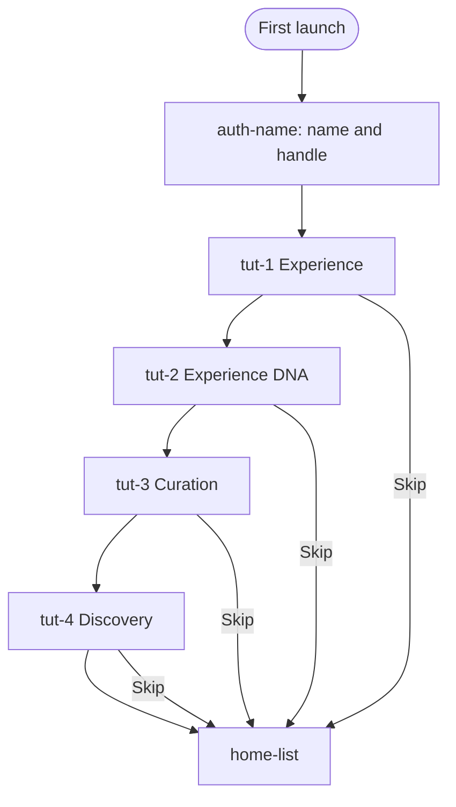
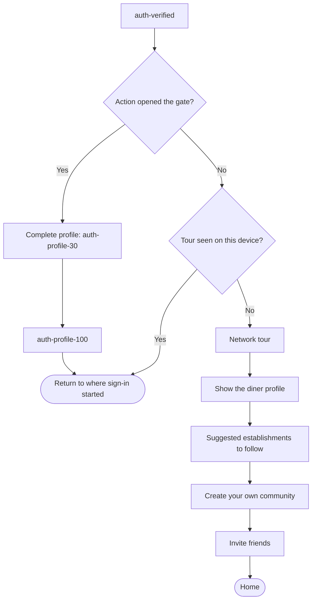

# Onboarding

Phase 1 does not ask for a phone number. The tutorial runs once, before Home. Each tutorial slide in the prototype can skip to Home.

The handle is checked against BE as it is typed (live 2026-10-24, api-reference §28). On `auth-name`, a typed handle that already exists shows "Already have an account? Sign in", which opens phone + OTP sign-in. The handle is claimed for the account at the first sign-in.

After Home, the diner is a named guest. Browsing, place profiles, and reading experiences stay open.

## Phase 3, after OTP verification

No screen in the design export covers this tour. The tour-seen flag stays on the device. A reinstall may show the tour again. No server flag. The tour ends on Home, and so does closing its "Start a curation" (2026-10-25).

Superseded 2026-10-01: "Phase 3, after the first successful sign-in" and "It is shown once, not on later logins." The old diagram always opened the tour, with Complete profile as an optional branch off `auth-verified`.

