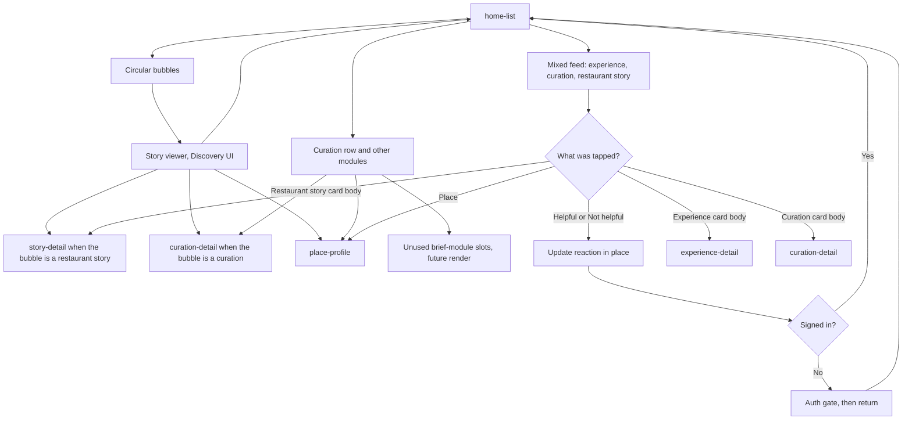

# Home

Home is one mixed list of three post types: experience, curation, and restaurant story. Helpful and Not helpful act on the card and do not open detail. Every other tap on a card opens detail.

At the top there is a curation row and other filtered modules (highlights, followed experiences, brand curation suggestions, place suggestions, brand promotions). Those modules come from separate calls with different arguments, not from the mixed list. The app will render unused brief-module slots in a later pass. They stay in this diagram.

The circular bubbles at the top are the followed authors (§23). Each bubble holds all of that author's posts, which can be experiences, curations or restaurant stories, and opens the story viewer in the Discovery UI. It plays like Instagram (2026-10-25): a photo for 1.5 s and a video for its length. A tap on the left third goes back and anywhere else goes on, crossing authors at either end. Holding pauses, a swipe across changes author, and a swipe down closes. A bubble watched through greys and moves to the end, and seen state stays on the device. Discovery is not a tab and not a separate feed.

The feed is ranked from a location: the device's position when permission is already given, else the listed city nearest the IP location (2026-10-26). Home never asks for location on open. "Use my location" in the location sheet asks.

Empty, offline, and error states stay on Home. They do not swap in demo cards.

The brand-promotions slot, once rendered, opens the same place, offer, or brand curation as a WhatsApp promotion.
