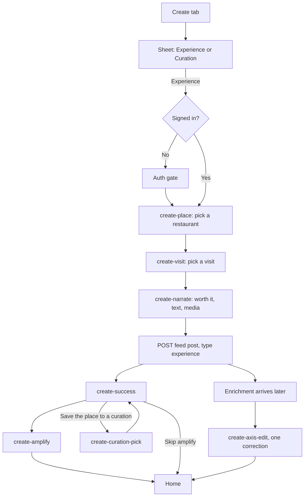

# Create an experience

Create on the tab bar is a sheet, not a screen. One choice is "create Experience". Posting requires a signed-in diner.

Worth it is a boolean on the experience. It is not the Helpful reaction.

A verified experience is one tied to a real visit and order. The visit step can be a reconciled payment, a bill photo still matching, a table QR, a waiter confirm, or no visit at all. That branch is [visit verification](./14-visit-verification.md). If the diner has no visit, the post is still allowed and stays unverified. Dish tags from the bill appear only when the visit is verified. There is no captured sample of that dish payload.

`create-axis-edit` edits inferred axes on the experience. It does not show restaurant DNA. Saving it spends the one correction, so it stays off until the diner changes a lean.

Save into a curation lives on `create-success` ("Save {place} to a curation"), not on the narrate step: the place is only worth saving once the experience is out.

On `create-narrate`, "Earn more tokens" lists the earn policy's conditions: a title and a write-up of its minimum length, and a verified visit for the bigger amount. Photos don't earn. The meter shows the most the post can earn, because user_svc's monthly caps aren't checked in the app (§26).

`create-amplify` lists each tier at what the buy will debit, which is user_svc's catalogue rate (§27). Picking one opens a confirm sheet with the cost, the balance and what's left. Only Confirm spends the Tokens.
